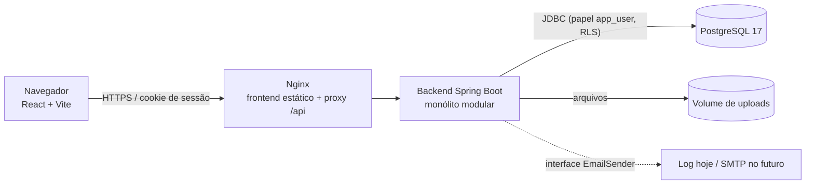
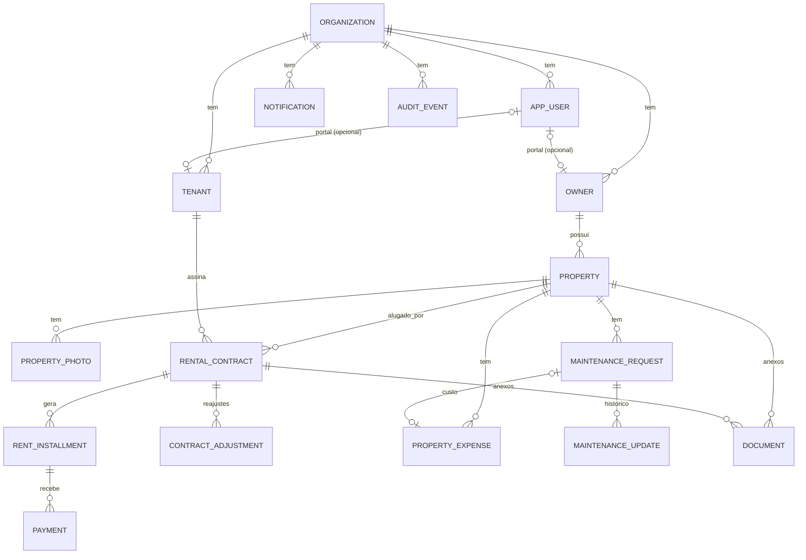

# Arquitetura

## Visão geral



- **Monólito modular** no backend: um deploy, módulos com fronteira clara. Microserviços não se justificam neste porte.
- **Frontend separado** (SPA), servido por Nginx que também faz proxy de `/api` → mesma origem, sem CORS em produção.
- **Arquivos** em volume local, atrás de endpoint autenticado. A interface `FileStorage` permite trocar por S3 depois.

## Backend

Pacote raiz `br.com.gestaoimoveis`. Um pacote por domínio, cada um com `api` (controllers + DTOs), `domain` (entidades + regras), `repository`, `service`:

```
auth  users  organizations  owners  tenants  properties  contracts
payments  expenses  maintenance  documents  notifications  reports  audit
shared  (erros, segurança, tenancy, dinheiro, storage, pdf)
```

Regras de dependência: controllers só falam com services do próprio módulo; um módulo usa outro **só pelo service público**, nunca pelo repository. Cada endpoint recebe e devolve DTOs (records), nunca a entidade JPA.

| Camada | Tecnologia |
|---|---|
| Web | Spring Web MVC, Bean Validation, Springdoc OpenAPI (`/api/docs`) |
| Segurança | Spring Security 6, sessão via Spring Session JDBC, CSRF por cookie |
| Persistência | Spring Data JPA / Hibernate, Flyway, PostgreSQL 17 |
| PDF | OpenPDF |
| Agendamento | `@Scheduled` (notificações diárias às 06:00) |
| Observabilidade | Logback JSON (logstash encoder), Actuator `health` |

### Autenticação

- Escolhemos **sessão no servidor** (Spring Session JDBC) em vez de JWT: revogação imediata no logout ou ao desativar o usuário, nada de token no `localStorage`, menos código para manter refresh tokens.
- Cookie `SESSION`: `HttpOnly`, `SameSite=Lax`, `Secure` quando `APP_COOKIE_SECURE=true`. Expira após 8 h de inatividade.
- CSRF: `CookieCsrfTokenRepository` → o frontend envia `X-XSRF-TOKEN` em todo método que altera dados.
- Limite de login: contador por (e-mail, IP) com janela de 15 min, salvo na tabela `login_attempt`, que continua valendo com mais de uma instância.

### Multi-organização (isolamento)

Modelo: **schema compartilhado** com `organization_id` em toda tabela de negócio. Isolamento em duas camadas:

1. **Aplicação**: o `organizationId` vem só da sessão (`CurrentUser`), nunca do corpo ou da URL. Todos os repositories filtram por ele. Buscar recurso de outra organização devolve **404** (não 403, para não revelar que o recurso existe).
2. **Banco (RLS)**: toda tabela com `organization_id` tem `ENABLE` + `FORCE ROW LEVEL SECURITY` e a política
   `USING (organization_id = current_setting('app.org_id')::uuid)`.
   O backend conecta como `app_user` (não é dono das tabelas, então não passa por cima do RLS). No início de cada transação o `TenantTransactionManager` executa `select set_config('app.org_id', :org, true)` (vale só para a transação).
   O Flyway roda como `app_owner`, dono do schema.
   Antes de existir organização na sessão há só duas portas:
   - **Cadastro:** o backend gera o UUID da organização nova e grava `app.org_id` com ele antes dos INSERTs. O RLS vale normalmente.
   - **Login:** a política `login_lookup` (só `SELECT` em `app_user`) libera a linha cujo e-mail é igual a `app.login_email`, gravado pelo backend na transação do login. Ninguém lê outras linhas, e não há função `SECURITY DEFINER` para manter.
   O Spring Session usa um gerenciador de transação JDBC próprio (as tabelas de sessão não têm RLS). Assim, carregar a sessão para descobrir o usuário não reabre o `TenantTransactionManager`.

Teste obrigatório: com dois tenants, cada endpoint de leitura e escrita é chamado com o ID de recurso do outro tenant e precisa responder 404. Uma query nativa sem filtro precisa retornar 0 linhas de outro tenant (prova de que o RLS funciona).

### Dinheiro

- `numeric(14,2)` no banco, `BigDecimal` na JVM, escala 2, `RoundingMode.HALF_EVEN`. Classe `Money` em `shared` concentra o arredondamento.
- Saldo da parcela = `valor - Σ pagamentos não estornados`. O saldo é calculado na hora e não fica gravado. Assim não existe valor gravado que fique fora de sincronia.
- Registro de pagamento numa transação com `SELECT ... FOR UPDATE` na parcela (evita pagar duas vezes em paralelo), mais `UNIQUE (organization_id, idempotency_key)`.
- Parcelas: uma por mês-calendário de ocupação, vencendo no `due_day` do mês seguinte. A primeira e a última são proporcionais (`valor × dias_ocupados / dias_do_mês`). Regra completa na seção "Regras de negócio" do PLANO.md, item 6.
- Testcontainers usa a mesma imagem `postgres:17-alpine` e o mesmo `docker/postgres/01-roles.sh`. Os testes rodam como `app_user`, então o RLS também é testado.

### Contratos sem conflito

Restrição no banco (extensão `btree_gist`):

```sql
EXCLUDE USING gist (property_id WITH =, daterange(start_date, end_date, '[]') WITH &&)
  WHERE (status = 'ATIVO')
```

O service verifica antes, para devolver uma mensagem amigável. A restrição garante a regra mesmo com duas requisições simultâneas.

### Uploads

- Tipo validado pelos **bytes iniciais** do arquivo (JPEG, PNG, WebP, PDF), não só pela extensão ou pelo Content-Type.
- Limites: imagem 5 MB, PDF 10 MB, requisição 25 MB.
- Gravado como `{org}/{uuid}` fora da pasta pública. O nome original fica só no banco.
- Download por `GET /api/files/{id}`, com checagem de organização e de visibilidade, `Content-Disposition: attachment` para PDFs e `X-Content-Type-Options: nosniff`.

### Erros

`@RestControllerAdvice` → `ProblemDetail` (RFC 9457) com `type`, `title`, `status`, `detail` e `errors[]` por campo. Exceções inesperadas são logadas com um `traceId`, e só esse `traceId` vai para o cliente.

### Auditoria

`AuditService.record(entity, entityId, action, before, after)` é chamado nos services de contratos, parcelas, pagamentos, despesas e usuários. Grava JSON do antes e do depois, já sem campos sensíveis. A tabela só recebe inserções: `app_user` não tem `UPDATE`/`DELETE` nela.

## Modelo de dados



Todas as tabelas de negócio: `id uuid PK`, `organization_id uuid NOT NULL`, `created_at`, `updated_at`, `version` (lock otimista).

| Tabela | Campos principais | Restrições e índices |
|---|---|---|
| organization | name, slug, plan, created_at | `UNIQUE(slug)` |
| app_user | email, password_hash, name, role, owner_id?, tenant_id?, active | `UNIQUE(lower(email))` global; CHECK role ∈ {ADMIN,STAFF,OWNER,TENANT} |
| owner | name, document, email, phone, address (jsonb), bank_info (jsonb), anonymized_at | `UNIQUE(org, document)` |
| tenant | name, document, email, phone, address (jsonb), anonymized_at | `UNIQUE(org, document)` |
| property | code, title, description, type, street, number, complement, district, city, state, zip, area_m2, bedrooms, bathrooms, parking, suggested_rent, status, owner_id | `UNIQUE(org, code)`; idx (org, city), (org, status), (org, type), (org, suggested_rent) |
| property_photo | property_id, file_id, position, is_cover | |
| rental_contract | property_id, owner_id, tenant_id, start_date, end_date, monthly_rent, due_day, adjustment_index, adjustment_percent?, guarantee_type, guarantee_value?, guarantee_notes, status, notes, previous_contract_id?, ended_at?, end_reason? | EXCLUDE de sobreposição (acima); CHECK end_date > start_date; CHECK due_day 1–28 |
| contract_adjustment | contract_id, percent, effective_date, old_rent, new_rent, user_id | |
| rent_installment | contract_id, reference_month, due_date, amount, status (ABERTA/CANCELADA; PARCIAL/PAGA/ATRASADA derivados) | `UNIQUE(contract_id, reference_month)`; idx (org, due_date) |
| payment | installment_id, paid_at, amount, method, reference, idempotency_key, user_id, reversed_at?, reversal_reason? | `UNIQUE(org, idempotency_key)`; CHECK amount > 0 |
| property_expense | property_id, category, date, amount, description, payer, maintenance_request_id? | idx (org, property_id, date) |
| maintenance_request | property_id, requester_user_id, description, priority, status, assignee_user_id?, cost?, opened_at, closed_at? | idx (org, status) |
| maintenance_update | request_id, user_id, from_status, to_status, comment | |
| stored_file | owner_type, owner_id, original_name, content_type, size, storage_key, visibility | |
| document | file_id, property_id?, contract_id?, title, visibility | CHECK (property_id ou contract_id) |
| notification | user_id?, role?, type, title, body, link, read_at, dedupe_key | `UNIQUE(org, dedupe_key)` (o job diário não duplica) |
| audit_event | user_id, entity, entity_id, action, before (jsonb), after (jsonb), at | só INSERT |
| login_attempt | email, ip, attempted_at, success | idx (email, ip, attempted_at) |

## Permissões

| Recurso | ADMIN | STAFF | OWNER | TENANT |
|---|---|---|---|---|
| Usuários / configurações | CRUD | — | — | — |
| Proprietários | CRUD | CRUD | próprio (leitura) | — |
| Imóveis | CRUD | CRUD | os seus (leitura) | o alugado (leitura) |
| Inquilinos | CRUD | CRUD | — (só o nome nos seus contratos) | próprio (leitura) |
| Contratos | CRUD + reajuste/encerrar | CRUD + reajuste/encerrar | os seus (leitura) | o seu (leitura) |
| Parcelas / pagamentos | lançar, estornar | lançar | dos seus imóveis (leitura) | as suas (leitura + recibo) |
| Despesas | CRUD | CRUD | dos seus imóveis (leitura) | — |
| Manutenção | CRUD | CRUD | dos seus imóveis (leitura) | abrir + acompanhar as suas |
| Documentos | CRUD | CRUD | visibilidade PROPRIETARIO | visibilidade INQUILINO |
| Relatórios / dashboard | sim | sim | portal | portal |
| Auditoria | leitura | — | — | — |

Implementação: `@PreAuthorize("hasAnyRole('ADMIN','STAFF')")` nos controllers internos. Os portais ficam em `/api/portal/owner/**` e `/api/portal/tenant/**`. Ali a consulta sempre filtra pelo `owner_id`/`tenant_id` do usuário logado, nunca por um parâmetro vindo do cliente.

## API REST (prefixo `/api`)

| Módulo | Endpoints |
|---|---|
| auth | `POST /auth/signup` (organização + admin), `POST /auth/login`, `POST /auth/logout`, `GET /auth/me`, `GET /auth/csrf` |
| users | `GET/POST /users`, `PATCH /users/{id}`, `POST /users/{id}/deactivate` |
| organizations | `GET/PATCH /organization` |
| owners | `GET/POST /owners`, `GET/PUT/DELETE /owners/{id}`, `POST /owners/{id}/anonymize` |
| tenants | `GET/POST /tenants`, `GET/PUT/DELETE /tenants/{id}`, `GET /tenants/{id}/contracts`, `POST /tenants/{id}/anonymize` |
| properties | `GET /properties?city&type&status&minRent&maxRent&q&page&size&sort`, `POST /properties`, `GET/PUT/DELETE /properties/{id}`, `POST /properties/{id}/photos` (multipart), `DELETE /properties/{id}/photos/{photoId}`, `PUT /properties/{id}/photos/{photoId}/cover`, `PATCH /properties/{id}/status` (DISPONIVEL/MANUTENCAO/INATIVO; OCUPADO só via contrato), `GET /properties/{id}/history` (Fase 3) |
| contracts | `GET/POST /contracts`, `GET/PUT /contracts/{id}`, `POST /contracts/{id}/activate`, `POST /contracts/{id}/adjust`, `POST /contracts/{id}/renew`, `POST /contracts/{id}/terminate`, `GET /contracts/{id}/history`, `GET /contracts/{id}/pdf`, `GET /contracts/expiring?days=60` |
| installments / payments | `GET /installments?contractId&propertyId&ownerId&tenantId&status&from&to`, `GET /installments/{id}`, `POST /installments/{id}/payments` (header `Idempotency-Key`), `POST /payments/{id}/reverse`, `GET /payments/{id}/receipt` |
| expenses | `GET/POST /expenses`, `PUT/DELETE /expenses/{id}` |
| maintenance | `GET/POST /maintenance`, `GET/PATCH /maintenance/{id}`, `POST /maintenance/{id}/updates`, `POST /maintenance/{id}/photos` |
| documents | `GET/POST /documents`, `DELETE /documents/{id}`, `GET /files/{id}` |
| notifications | `GET /notifications`, `POST /notifications/{id}/read`, `POST /notifications/read-all` |
| reports | `GET /dashboard`, `GET /dashboard/financial?from&to`, `GET /reports/{tipo}?from&to&format=json\|csv\|pdf`, `GET /calendar?month=YYYY-MM` |
| audit | `GET /audit?entity&entityId` |
| portal | `GET /portal/owner/{properties,contracts,installments,expenses}`, `GET /portal/tenant/{contract,installments,maintenance}`, `POST /portal/tenant/maintenance` |

Paginação: `?page=0&size=20&sort=campo,asc`, resposta `{content, page, size, totalElements, totalPages}`.

## Frontend

```
src/
  app/          rotas, layout (sidebar + topbar), providers (QueryClient, tema)
  components/ui shadcn/ui (button, input, dialog, table, ...)
  components/   DataTable, Money, StatusBadge, EmptyState, ErrorState, PageHeader, FileUpload
  features/<módulo>/  api.ts (hooks TanStack Query) · schemas.ts (zod) · páginas
  lib/          api (fetch + CSRF + problem+json), format (BRL, datas), auth
```

- Vite + React + TypeScript (strict), Tailwind CSS, shadcn/ui (Radix, acessível), React Router, TanStack Query, React Hook Form + Zod, Recharts, Lucide.
- Chamadas com `fetch` (sem axios: uma dependência a menos), `credentials: 'include'` e CSRF automático.
- Proteção de rota por perfil: `/app/**` para ADMIN/STAFF, `/portal/owner/**` e `/portal/tenant/**` para os portais.
- Toda página que busca dados trata quatro estados: carregando (skeleton), vazio, erro (com "tentar novamente") e sucesso.
- Tema claro/escuro com a classe `dark` no `<html>`, salvo em `localStorage`, seguindo o sistema por padrão.

## Infraestrutura

- `docker-compose.yml`: `db` (Postgres 17), `backend` (JRE 21, imagem multi-stage), `frontend` (build do Vite servido pelo Nginx). Volumes: `pgdata`, `uploads`.
- `docker/postgres/01-roles.sh`: cria os papéis `app_owner` (Flyway) e `app_user` (aplicação).
- Perfil `demo` do Spring: carrega dados fictícios (2 organizações, 30 imóveis, contratos e pagamentos) para a demonstração.
- GitHub Actions: `backend` (`./mvnw verify` com Testcontainers), `frontend` (lint, typecheck, vitest, build), `e2e` (compose + Playwright).
